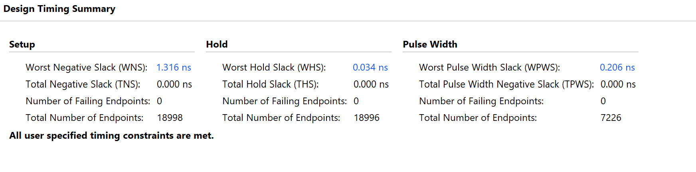
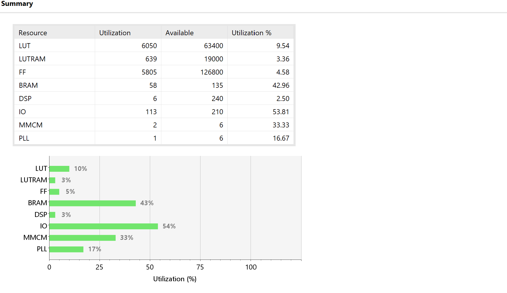

# FPGA Automotive Video Compositor — Nexys 4 DDR

This project implements a real-time automotive dashboard and video-mixing pipeline on a Xilinx Artix-7 FPGA. The system captures RGB565 video from an OV7670 camera, crosses asynchronous clock domains using a custom Gray-code FIFO, buffers video and graphics through external DDR2 memory, arbitrates multiple memory clients, and composites live video with graphics using fixed-point alpha blending and prioritized alert overlays.

The final design outputs a 640×480 VGA dashboard and closes post-implementation timing with **+1.316 ns WNS, 0.000 ns TNS, and zero failing endpoints**.

---

## Hardware and Tools

- **FPGA Board:** Digilent Nexys 4 DDR
- **FPGA:** Xilinx Artix-7 `XC7A100T-1CSG324C`
- **Camera:** HiLetgo OV7670 parallel camera module
- **Camera Format:** RGB565
- **External Memory:** 128 MiB DDR2
- **Display Output:** 640×480 VGA
- **Monitor Connection:** Nexys VGA → active VGA-to-HDMI converter → HDMI monitor
- **HDL:** Verilog
- **Development Environment:** AMD Vivado 2025.2
- **User Inputs:** `SW[15:0]`, `BTNC`, `BTNL`, and `BTNR`

The project uses the **Nexys 4 DDR Master XDC** for physical pin assignments. Constraints from the original Nexys 4 should not be substituted because the memory hardware and several board connections differ.

---

## System Architecture

The design is separated into multiple hardware blocks operating across independent clock domains.

```text
                         OV7670 Camera
                              |
                         RGB565 Pixels
                              |
                         CAM_PCLK Domain
                              |
                              v
                    +--------------------+
                    |   Camera Capture   |
                    +--------------------+
                              |
                              v
                    +--------------------+
                    |  Gray-Code Async   |
                    |  FIFO / CDC Bridge |
                    +--------------------+
                              |
                              v
                     Memory / MIG Domain
                              |
          +-------------------+-------------------+
          |                   |                   |
          v                   v                   v
   Camera Writer       Graphics Writer      Display Reader
          \                   |                   /
           \                  |                  /
            +-----------------------------------+
            |      Custom DDR Memory Arbiter    |
            | Display Priority + Writer Fairness|
            +-----------------------------------+
                              |
                              v
                    +--------------------+
                    | 128 MiB DDR2 / MIG |
                    +--------------------+
                              |
                              v
                    +--------------------+
                    |   Display Cache    |
                    +--------------------+
                              |
                              v
                    +--------------------+
Camera Layer ------>|                    |
Graphics Layer ---->|   Alpha Blender    |
                    |   6 DSP Slices     |
                    +--------------------+
                              |
                              v
                    +--------------------+
                    | Priority Compositor|
                    |                    |
                    | NORMAL             |
                    | WARNING            |
                    | CRITICAL           |
                    +--------------------+
                              |
                              v
                         640×480 VGA
```

---

## Major Features

- Live RGB565 capture from an OV7670 camera
- Custom Gray-code asynchronous FIFO for clock-domain crossing
- External 128 MiB DDR2 framebuffer using Xilinx MIG
- Custom multi-client DDR memory arbitration
- Display-read priority to reduce video starvation
- Camera and graphics DDR clients
- DDR-backed graphics layer
- Fixed-point RGB alpha blending
- Six DSP slices used for hardware multiplication
- Per-pixel priority compositor
- NORMAL, WARNING, and CRITICAL display modes
- CRITICAL overlay priority over WARNING overlays
- Double-buffered/cached display architecture
- 640×480 VGA dashboard output
- Post-implementation timing closure with zero failing endpoints

---

## Video Pipeline

The OV7670 sensor supports a native VGA resolution of **640×480**.

The current implementation captures RGB565 camera data and stores a reduced **160×120** camera image for the dashboard video window. The image is scaled and composited into the final **640×480 VGA output**.

The lower stored camera resolution was chosen so the project could focus on the FPGA architecture itself, including:

- Clock-domain crossing
- External DDR access
- Memory arbitration
- Double buffering
- Fixed-point alpha blending
- Priority-based real-time compositing

The final VGA display itself operates at 640×480.

---

## Clock Domain Crossing

The OV7670 pixel clock operates asynchronously from the FPGA memory and display clock domains.

A custom dual-clock asynchronous FIFO safely transfers camera pixels between the camera clock domain and the internal memory/system domain.

The FIFO uses binary pointers internally and converts them to Gray code before synchronization.

```text
Binary Write Pointer
        |
        v
 Gray-Code Conversion
        |
        v
 2-FF Synchronizer
        |
        v
 Read Clock Domain
```

Gray-code pointer synchronization is used because only one pointer bit changes between adjacent Gray-code values, reducing the possibility of an incoherent multi-bit value being sampled across an asynchronous clock boundary.

Vivado asynchronous clock-group constraints are used so intentional CDC paths are not incorrectly analyzed as normal synchronous register-to-register paths.

---

## DDR2 Framebuffer

The Nexys 4 DDR contains **128 MiB of external DDR2 memory**.

The Xilinx Memory Interface Generator (MIG) handles the low-level physical DDR2 interface.

Custom Verilog logic handles the higher-level video traffic and memory transactions.

Before integrating video, the DDR2 subsystem was independently verified by:

```text
Write Known Data
      |
      v
     DDR2
      |
      v
Read Data Back
      |
      v
 Compare
      |
      +---- PASS
      |
      +---- FAIL
```

After standalone memory verification, the camera and graphics pipelines were connected to the DDR subsystem.

---

## Custom DDR Memory Arbitration

Multiple hardware blocks require access to the DDR memory system:

```text
Display Reader
Camera Writer
Graphics Writer
```

A custom memory arbiter controls access between these clients.

The display reader is given the highest priority because display starvation can create visible corruption or missing pixels.

When the display is not requesting memory, camera and graphics traffic share the remaining memory bandwidth.

Conceptually:

```text
if Display requests memory:
    Grant Display

else if Camera and Graphics both request:
    Alternate between Camera and Graphics

else:
    Grant the requesting writer
```

This architecture protects the real-time display path while preventing the camera and graphics writers from permanently starving one another.

---

## Alpha Blending

Camera and graphics pixels are combined using fixed-point alpha blending.

The compositor implements the equivalent of:

```text
Output =
    Foreground × Alpha
    +
    Background × (1 - Alpha)
```

Floating-point arithmetic is not required.

Alpha values are represented as fixed-point integers and the final arithmetic is scaled using binary shifts.

The RGB blending pipeline uses dedicated FPGA DSP resources.

The final implementation uses:

```text
6 DSP slices
```

for the alpha-blending datapath.

The blender is pipelined to meet the 100 MHz system timing requirement.

---

## Graphics Overlay

The graphics layer is blended with the live camera image.

Example overlay elements include:

```text
+--------------------------------+
|                                |
|   +------------------------+   |
|   |       CAMERA HUD       |   |
|   |                        |   |
|   |         +              |   |
|   |       RETICLE          |   |
|   |                        |   |
|   |  |                     |   |
|   |  | MOVING SCAN LINE    |   |
|   |  |                     |   |
|   +------------------------+   |
|                                |
+--------------------------------+
```

The graphics are generated from the current pixel coordinates and blended with the camera layer in real time.

---

## Priority Compositor

The final video stage contains a per-pixel priority compositor.

Three alert levels are supported:

```text
NORMAL
   |
   v
WARNING
   |
   v
CRITICAL
```

### NORMAL

Displays the live camera feed, dashboard graphics, HUD elements, and standard vehicle information.

### WARNING

Adds a translucent amber/yellow warning layer while preserving the underlying camera and dashboard pixels.

### CRITICAL

Displays the highest-priority red alert layer.

The CRITICAL layer overrides WARNING wherever the two overlays overlap.

The compositor evaluates the current VGA pixel position and selects the highest-priority valid layer for that pixel.

Conceptually:

```text
if critical_pixel:
    output = critical_blend

else if warning_pixel:
    output = warning_blend

else if hud_pixel:
    output = hud_blend

else:
    output = camera/background
```

This means priority is handled on a pixel-by-pixel basis rather than switching between complete pre-rendered screens.

---

## Timing Closure

The final implemented design meets all user-specified timing constraints.

| Timing Metric | Final Result |
|---|---:|
| Worst Negative Slack (WNS) | **+1.316 ns** |
| Total Negative Slack (TNS) | **0.000 ns** |
| Setup Failing Endpoints | **0** |
| Worst Hold Slack (WHS) | **+0.034 ns** |
| Total Hold Slack (THS) | **0.000 ns** |
| Hold Failing Endpoints | **0** |
| Worst Pulse Width Slack | **+0.206 ns** |
| Pulse Width Failing Endpoints | **0** |

Vivado reports:

```text
All user specified timing constraints are met.
```

During development, the alpha-blending path originally failed setup timing.

The critical path was approximately:

```text
Display Cache BRAM
       |
       v
RGB / Alpha Logic
       |
       v
Multiplier
       |
       v
Multiplier Register
```

An additional pipeline stage was inserted before the multiplication stage, and the multipliers were mapped to dedicated DSP resources.

After pipelining, the design improved to:

```text
WNS = +1.316 ns
TNS = 0.000 ns
Failing Endpoints = 0
```

---

## FPGA Resource Utilization

Final post-implementation utilization on the Artix-7 XC7A100T:

| Resource | Used | Available | Utilization |
|---|---:|---:|---:|
| LUT | 6,050 | 63,400 | **9.54%** |
| LUTRAM | 639 | 19,000 | **3.36%** |
| Flip-Flops | 5,805 | 126,800 | **4.58%** |
| Block RAM | 58 | 135 | **42.96%** |
| DSP | 6 | 240 | **2.50%** |
| I/O | 113 | 210 | **53.81%** |
| MMCM | 2 | 6 | **33.33%** |
| PLL | 1 | 6 | **16.67%** |

An earlier implementation incorrectly inferred the large display caches as distributed LUT RAM.

That version exceeded the available LUTRAM resources.

The caches were redesigned using a dual-clock Block RAM inference structure, which moved the large video buffers into dedicated BRAM resources.

The final implementation uses only **3.36% LUTRAM** while using **42.96% of the available BRAM**.

---

## Development Stages

The system was developed incrementally so each major subsystem could be verified before integration.

```text
Stage 1
Static VGA dashboard graphics

Stage 2
Dashboard UI and VGA timing

Stage 3
OV7670 clock and synchronization diagnostics

Stage 4
Camera pixel-bus verification

Stage 5
Live RGB565 camera integration

Stage 6
Custom Gray-code asynchronous FIFO

Stage 7
DDR2 / MIG standalone verification

Stage 8
DDR-backed video framebuffer

Stage 9
Custom multi-client DDR arbitration

Stage 10
DDR graphics + fixed-point alpha blending

Stage 11
NORMAL / WARNING / CRITICAL priority compositor

Stage 12
Timing closure, CDC constraints, and implementation verification
```

---

## Verification

Subsystems were tested independently before integration into the final design.

Verification included:

- OV7670 clock generation
- Camera PCLK detection
- VSYNC detection
- HREF detection
- Camera D0-D7 pixel-bus activity
- RGB565 color verification
- Gray-code CDC FIFO operation
- External DDR2 calibration
- DDR2 write/read verification
- DDR video-frame storage
- Camera/graphics/display memory arbitration
- Fixed-point alpha blending
- DSP-based multiplication
- NORMAL/WARNING/CRITICAL priority behavior
- BRAM inference verification
- Setup timing analysis
- Hold timing analysis
- CDC constraint verification
- Post-implementation resource utilization

Final timing analysis contains:

```text
0 setup failing endpoints
0 hold failing endpoints
0 pulse-width failing endpoints
```

---

## Hardware Results

The completed system displays a real-time automotive-style interface with:

```text
+------------------------------------------------+
| SPEED                       BATTERY / STATUS   |
|                                                |
|       +-------------------------------+        |
|       |                               |        |
|       |       LIVE CAMERA VIDEO       |        |
|       |                               |        |
|       |      HUD / ALPHA OVERLAY      |        |
|       |                               |        |
|       +-------------------------------+        |
|                                                |
| TURN / ALERT / SYSTEM STATUS                   |
+------------------------------------------------+
```

The display supports real-time changes between:

```text
NORMAL
WARNING
CRITICAL
```

with CRITICAL receiving the highest compositor priority.

---

## Vivado Results

### Timing

Final post-implementation timing:

```text
WNS: +1.316 ns
TNS: 0.000 ns
Setup Failing Endpoints: 0

WHS: +0.034 ns
THS: 0.000 ns
Hold Failing Endpoints: 0

Worst Pulse Width Slack: +0.206 ns
Pulse Width Failing Endpoints: 0
```


```markdown

```

### Utilization


```markdown

```

---

## What This Project Demonstrates

This project goes beyond generating a graphical dashboard.

It demonstrates several FPGA and digital-design concepts commonly used in real-time video and embedded display systems:

```text
Clock Domain Crossing
Gray-Code Synchronization
Asynchronous FIFOs
External DDR Memory
Memory Arbitration
Double Buffering
Block RAM
DSP-Based Arithmetic
Fixed-Point Processing
Alpha Blending
Video Compositing
Layer Priority
Pipelining
Timing Closure
FPGA Resource Optimization
```

The final system combines camera acquisition, asynchronous clock-domain crossing, external memory, real-time graphics generation, memory scheduling, hardware arithmetic, and per-pixel video compositing on a single Artix-7 FPGA.

---

## Final Results

The completed design achieves:

```text
640×480 VGA output

128 MiB external DDR2

Custom Gray-code CDC FIFO

Three-client DDR memory arbitration

DDR-backed camera and graphics pipeline

Fixed-point alpha blending

6 DSP slices used for blending

NORMAL / WARNING / CRITICAL priority compositor

+1.316 ns WNS

0.000 ns TNS

0 failing timing endpoints

9.54% LUT utilization

4.58% FF utilization

42.96% BRAM utilization
```

The final implemented design meets all user-specified Vivado timing constraints while maintaining real-time live video and graphics composition.
